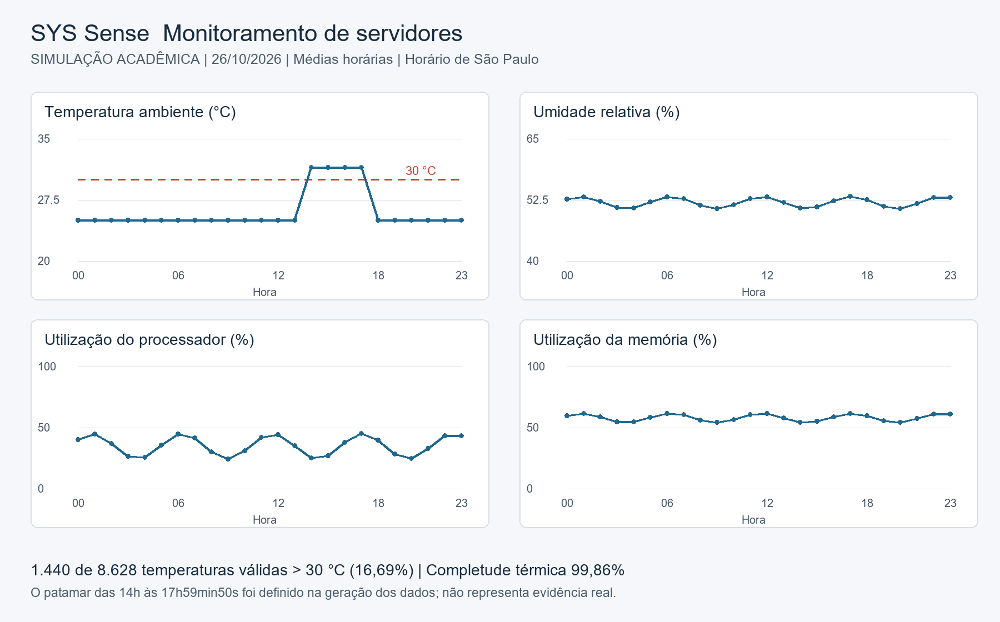

# SYS Sense

Protótipo acadêmico de análise do monitoramento de servidores e condições ambientais, desenvolvido por Diego Fernandes Xavier, Grupo 4, na disciplina Metodologias para Projetos de Big Data Analytics da Fatec Ipiranga.

## Problema e objetivo

Identificar os horários em que a temperatura ambiental supera 30 °C, organizando os dados para apoiar a priorização de inspeções de climatização e ventilação. O limiar é uma referência deste estudo e precisa ser validado conforme os equipamentos em uma implantação real.

## Natureza dos dados

Todos os dados deste pacote são sintéticos e gerados pelo script. Não são medições de servidores ou de sensores físicos. ESP32 e NUC7080 são identificadores lógicos usados na simulação. A janela de calor entre 14h e antes de 18h e as médias foram definidas na geração para demonstrar o método e manter coerência com a documentação. Portanto, o padrão encontrado comprova o funcionamento da regra no cenário construído, sem validar sua frequência ou utilidade em produção.

O período de referência é 26/10/2026, com 8.640 horários a cada dez segundos. Os horários são locais de São Paulo e não contêm deslocamento UTC no CSV. Doze temperaturas foram omitidas no início do dia e oito registros duplicados foram acrescentados intencionalmente.

## Como executar

Requisitos: Python 3.10 ou superior e Pillow para gerar o painel. Nenhuma conta, senha ou serviço externo é necessário.

```bash
python -m pip install -r requirements.txt
python scripts/pipeline.py
```

O caminho do projeto é calculado pelo próprio script. A execução pode ocorrer em qualquer diretório quando o caminho do script é informado. Cada execução regenera e substitui as saídas em `data/` e `results/`, incluindo as duas tabelas SQLite do protótipo. Preserve fora dessas pastas qualquer dado real ou alteração manual.

## Pipeline

Geração de dados sintéticos → leitura e validação → deduplicação por dispositivo e horário → tratamento de campos não aplicáveis → integração dos dois canais pelo horário → CSV e SQLite → regra térmica e agregação horária → métricas e painel.

As temperaturas ausentes permanecem nulas, inclusive no indicador. Não recebem zero, média ou classificação de normalidade. Percentuais preenchidos precisam estar entre 0 e 100. O processamento interrompe se houver inconsistência nas verificações implementadas.

## Estrutura

```text
SYS_Sense/
  README.md
  requirements.txt
  scripts/pipeline.py
  data/
    registros_origem.csv
    registros_tratados.csv
    monitoramento.csv
    resumo_horario.csv
    monitoramento.db
  results/
    dashboard.png
    metricas.json
    sha256.json
  docs/
    Documentacao_SYS_Sense.docx
    Portfolio_SYS_Sense.pdf
    canvas.png
    pipeline.png
    kanban.png
    kanban.csv
    linkedin.txt
    roteiro_video.txt
    entrega.txt
```

## Dicionário da base consolidada

| Campo | Significado |
| --- | --- |
| data_hora | Horário local de referência, em intervalos de dez segundos |
| servidor | Identificador lógico NUC7080 |
| temperatura_ambiente_c | Temperatura ambiental em °C; doze valores ausentes |
| umidade_relativa_pct | Umidade relativa em % |
| uso_cpu_pct | Utilização do processador em %; não é temperatura da CPU |
| uso_memoria_pct | Utilização da memória RAM em % |
| tempo_atividade | Duração simulada de atividade do servidor |
| temperatura_acima_30_c | 1 para temperatura > 30 °C, 0 para ≤ 30 °C e vazio para ausente |

## Resultados reproduzíveis

| Medida | Resultado |
| --- | ---: |
| Linhas de origem | 17.288 |
| Duplicatas removidas | 8 |
| Registros tratados dos dois canais | 17.280 |
| Horários consolidados | 8.640 |
| Temperaturas válidas | 8.628 |
| Temperaturas ausentes | 12 |
| Leituras > 30 °C | 1.440 |
| Percentual entre temperaturas válidas | 16,69% |
| Completude térmica | 99,86% |

O indicador é `1440 / 8628 × 100`. As leituras acima do limite começam às 14h00min00s e terminam às 17h59min50s. A recomendação ilustrada é priorizar inspeções nessa janela do cenário simulado. Cada leitura é uma ocorrência de medição, sem equivalência automática com uma falha ou uma mensagem de alerta.

As médias gerais são 26,09 °C, 52,05% de umidade, 35,43% de CPU e 58,20% de memória. A primeira hora tem 348 temperaturas válidas; as demais, 360. Os resumos trazem média, mínimo, máximo e contagem válida de cada variável. O painel utiliza médias horárias; o indicador térmico utiliza as leituras individuais.



## Validação

O script confere as contagens, a chave única, o intervalo temporal, os canais, os percentuais, as médias e a reconciliação do resumo com os registros. Também valida a integridade SQLite, os nulos e a contagem térmica no banco. `results/metricas.json` registra os resultados e `results/sha256.json` permite comparar CSVs, métricas e painel entre execuções no mesmo ambiente. A reprodutibilidade dos pixels depende também das versões do Pillow e das fontes disponíveis.

## Metodologias

CRISP-DM relaciona o problema à avaliação e à entrega. KDD estrutura a seleção, preparação, transformação e interpretação. Scrum é uma adaptação didática para trabalho individual, com responsabilidades acumuladas, sem representar um time completo. Kanban registra o fluxo e as pendências. DataOps orienta validação e repetição do lote; agendamento, ingestão contínua e alertas ainda são evolução proposta.

## Limites e próximos passos

O pacote demonstra um protótipo local de pequeno volume. Não inclui infraestrutura distribuída, previsão de falhas, coleta física, FastAPI em execução ou envio de mensagens. As tecnologias do integrador anterior são referência de arquitetura. A próxima etapa é coletar medições reais, validar limiares com a equipe responsável e avaliar se o monitoramento melhora o tempo de resposta.

## Autoria e referências do projeto

A documentação fornecida identifica como referência o integrador SYS Sense de 2025, de Diego Fernandes Xavier, Ewerton Mendes, Thaís Aparecida de Souza Martins e Victor Augusto Pires e Silva, com orientação de Rogério Tergolina. O trabalho atual é individual, de Diego Fernandes Xavier, Grupo 4, com orientação acadêmica indicada de Samuel Henrique da Rocha.

Os materiais didáticos do professor orientam a estrutura. O repositório deve conter os resultados do projeto, sem republicar a íntegra das aulas ou os arquivos de terceiros sem autorização.

## Publicações

[Repositório do projeto](https://github.com/DiegoFernandes244/sys-sense-analytics) · [Postagem no LinkedIn](https://www.linkedin.com/feed/update/urn:li:activity:7527448032095899648/)

## Quadro Kanban

[SYS Sense Kanban Grupo 4](https://github.com/users/DiegoFernandes244/projects/1)

O quadro público contém nove cartões e registra o estado atual das entregas de forma retrospectiva. Responsável por todos os cartões: Diego Fernandes Xavier. Limite de trabalho em andamento: 1. A captura em docs/kanban_github.png registra o momento de finalização, quando a inclusão da própria captura ainda estava em andamento.

## Canvas e encerramento

O Canvas foi importado para o Canva e exportado em PNG (1920 × 1540 pixels). A versão exportada está em [docs/canvas_canva.png](docs/canvas_canva.png) e integra a documentação. O quadro registra oito entregas concluídas e o vídeo dispensado pelo autor em 14/11/2026. Nenhum vídeo foi gravado ou publicado.

## Perfis e repositório

[Repositório do projeto](https://github.com/DiegoFernandes244/sys-sense-analytics) · [Perfil no LinkedIn](https://www.linkedin.com/in/diego-fernandes-xavier-759308145/)
